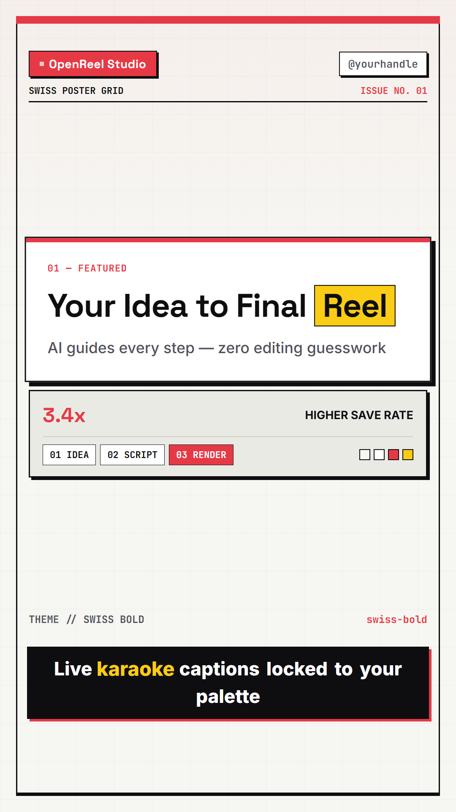
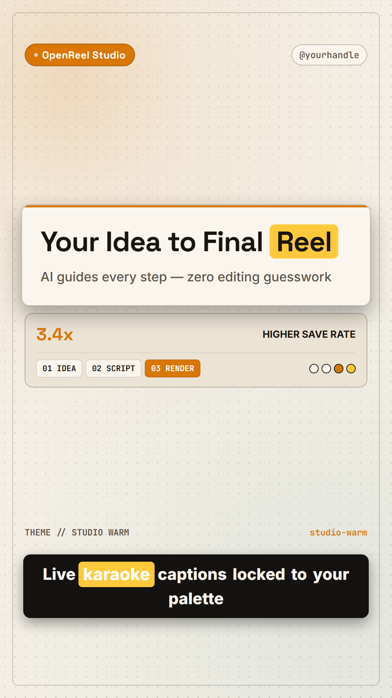
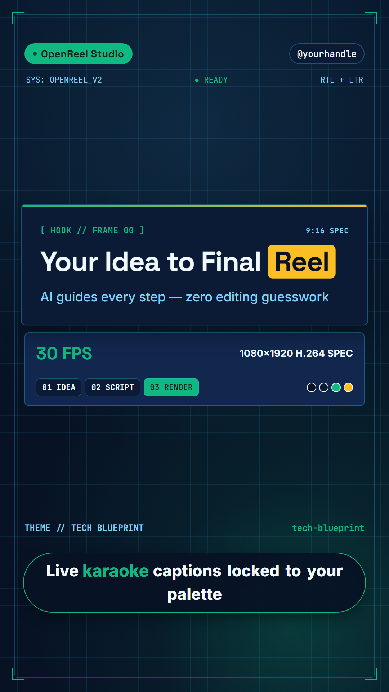

# OpenReel

[](LICENSE)
[](#quick-start)
[](#built-in-visual-themes)
[](#quick-start)

**An open-source AI video studio for vertical 9:16 Reels, TikTok, YouTube Shorts, and Facebook Reels.**  
Runs inside **Antigravity** and **Claude Code** — built for both **non-coders** and **developers**, in **Arabic (RTL)** and **English (LTR)**.

> **Your taste stays in files, not lost inside old chats.**  
> Paste one setup prompt in an empty folder: OpenReel clones itself, checks Node, interviews you about your niche and voice, renders **4 real 1080×1920 theme previews** for your topic so you pick visually, adapts to whatever tools you own (from 100% free pure code to Camera + Screen or AI Media), auto-cuts pauses, syncs karaoke captions, adds transitions & built-in SFX, and lets you tweak anything in plain chat.

---

## Quick Start

### For Everyone (Zero Setup — Open an Empty Folder & Paste One Prompt)
1. Open a new empty folder in **Antigravity** or **Claude Code** (only requirement: [Node.js 20+ LTS](https://nodejs.org)).
2. Paste **one** of the setup prompts below — the AI clones OpenReel into the folder, installs dependencies automatically, interviews you, and renders 4 custom theme previews:

#### English Setup Prompt
```text
Clone OpenReel from https://github.com/Abdelrahmanez/openreel.git directly into this folder (run `git clone https://github.com/Abdelrahmanez/openreel.git .` if the folder is empty and git is installed; otherwise download and extract the main branch ZIP directly into this folder). Read FACTORY_CORE.md and immediately run the start-factory onboarding skill. Run `npm run setup` yourself, ask me the onboarding questions clearly step by step, and render the 4 theme previews using a real headline from my niche so I can choose visually.
```

#### برومبت التجهيز بالعربي (انسخه زي ما هو)
```text
نزّل مشروع OpenReel من https://github.com/Abdelrahmanez/openreel.git مباشرة جوه الفولدر الحالي (نفّذ `git clone https://github.com/Abdelrahmanez/openreel.git .` لو الفولدر فاضي و git متسطب؛ ولو مش متسطب نزّل الـ ZIP للـ main branch وفكّه مباشرة جوه الفولدر). اقرأ ملف FACTORY_CORE.md وابدأ معايا فوراً رحلة التجهيز (start-factory skill) بالعربي. نفّذ `npm run setup` بنفسك، اسألني أسئلة الإعداد خطوة بخطوة، ورنّدرلي الـ 4 تصاميم (previews) بعنوان حقيقي من مجالي عشان أختار منهم بعيني.
```

### For Developers (Manual CLI)
```bash
git clone https://github.com/Abdelrahmanez/openreel.git .
npm run setup
npm run previews
```
Then open the folder in Antigravity or Claude Code and say **`Start`** or **`ابدأ`**.

---

## What OpenReel Actually Does (Out of the Box)

| Capability | How It Works (Zero Python) | Command / File |
|---|---|---|
| **Persistent Taste & Identity** | Saves your niche, tone, chosen theme, font preset, and style overrides in markdown + TypeScript | `docs/STRATEGY.md`, `docs/BRAND.md`, `editor/src/brand/brand.config.ts` |
| **4 Custom 1080×1920 Previews** | Renders 4 distinct visual styles using your real topic + handle before writing a single script | `npm run previews` |
| **Auto-Cut Dead Air & Pauses** | Single-pass synchronized FFmpeg silence detection + `-14 LUFS` loudness norm (uses Remotion's bundled FFmpeg — zero extra install!) | `npm run cut -- raw.mp4 clean.mp4` |
| **Auto-Captions & Karaoke Sync** | Local CPU Whisper (`@remotion/install-whisper-cpp`), Groq/OpenAI Whisper API, or `.srt` + script alignment for typo-free Arabic/English word timings | `npm run transcribe` / `npm run captions` |
| **10 Modular Scene Types** | `hook`, `talking-head`, `media` (images/AI video + Ken Burns/phone mockup), `split`, `stat`, `steps`, `compare`, `quote`, `bar-chart`, `cta` | `editor/src/compositions/ReelTemplate.tsx` |
| **Transitions & Built-In SFX** | CSS-safe `fade`/`slide`/`wipe`/`cut` transitions + 6 synthesized royalty-free WAVs (`impact`, `whoosh`, `pop`, `ding`, `click`, `riser`) | `editor/public/sfx/*.wav` |
| **Chat-to-Edit Tweaks** | Say `"make the hook bigger"` / `"كبّر الهوك"` or `"switch to karaoke captions"` → updates `overrides`, renders fast preview stills, and optionally saves to your brand defaults | `npm run render -- reels/01_topic --preview` |

---

## Built-In Visual Themes (1080×1920)

| `editorial-dark` | `swiss-bold` | `studio-warm` | `tech-blueprint` |
|---|---|---|---|
|  |  |  |  |
| Deep obsidian slate, electric cyan, amber marker & karaoke captions | Gallery off-white, sharp black ink frame, vermilion & yellow | Warm dotted paper, espresso ink, amber & mustard accents | Midnight engineering grid, cyan brackets, emerald proof & pill captions |

---

## Adaptive Visual Modes (`docs/TOOL_MODE.md`)

1. **Mode 1 — Zero Paid Tools (100% Free):** Pure Remotion motion graphics (`hook`, `stat`, `steps`, `compare`, `quote`, `bar-chart`, `cta`).
2. **Mode 2 — Camera + Screen:** Talking-head video (`talking-head`) auto-cut with `auto-cut.mjs` + `split` screen + screen recordings (`media`).
3. **Mode 3 — Image AI Only:** Palette-matched `9:16` image prompts + `media` Ken Burns motion & overlays.
4. **Mode 4 — Image + Video AI:** Start-Frame image prompts + static-camera video prompts + Remotion overlays, captions & SFX.

---

## The 6-Step AI Pipeline (Antigravity + Claude Code)

Skills live in `.claude/skills/` and stay synced to `.agents/skills/` via `npm run sync-skills`:

1. **`start-factory`** — Auto-installs, interviews you, renders 4 niche previews, lets you tweak accent/highlight colors, and saves your brand & mode files.
2. **`make-idea`** — Brainstorms 5 niche-specific ideas passing a 5-point filter.
3. **`make-script`** — Researches facts, writes 3–5 scored hooks, enforces the Delete Test, and maps beats to OpenReel's 10 scene types.
4. **`make-visuals`** — Produces shot lists, screen capture briefs, pure-code scenes, or palette-locked AI prompts based on your `TOOL_MODE.md`.
5. **`build-reel`** — Runs `auto-cut` (for camera footage), generates word-synced `captions.json`, builds `reel.json`, inspects `--preview` frames, handles instant Chat-to-Edit tweaks (`"كبّر الهوك"`), and exports final `1080×1920` `.mp4` + `cover.png`.
6. **`package-post`** — Writes platform-native captions for Instagram Reels, TikTok, YouTube Shorts, and Facebook Reels.

---

## نبذة سريعة بالعربي

**OpenReel** هو ستوديو مفتوح المصدر لصناعة الريلز والفيديوهات الرأسية (`9:16` لإنستجرام، تيك توك، يوتيوب شورتس، وفيسبوك) بيشتغل جوه **Antigravity** أو **Claude Code**.

- **تجهيز في خطوة واحدة:** تفتح فولدر فاضي، تلزق برومبت التجهيز، وهو يسحب المشروع ويسطّب ويسألك عن مجالك وطريقتك ويرندرلك ٤ تصاميم بأفكار من مجالك.
- **بيحفظ ذوقك في ملفات:** هويتك وألوانك وخطوطك واختياراتك بتتسجل في ملفات المشروع عشان ما تعيدش شرح نفسك في كل فيديو.
- **مونتاج حقيقي مش كلام:** سواء بتصور بوشك (`auto-cut` لقص الفراغات + كابشن عربي متزامن + موشن + مؤثرات صوتية مدمجة) أو بتشتغل ١٠٠٪ بالكود والذكاء الاصطناعي.
- **تعديل بالكلام:** تقدر تقوله «كبّر الهوك» أو «غيّر شكل الكابشن» فيعدل فوراً ويوريك الفريم.

---

## License

[MIT](LICENSE)
