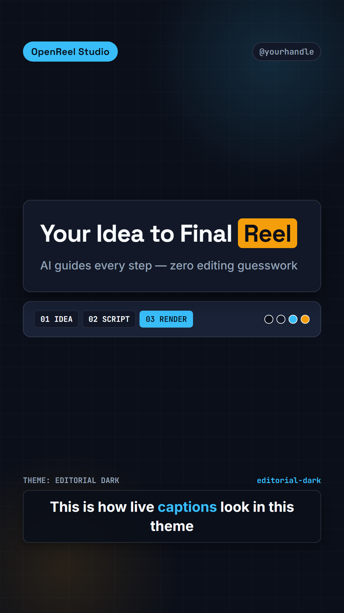

# OpenReel

[](LICENSE)
[](#quick-start)
[](#built-in-visual-themes)
[](#quick-start)

**An AI-driven vertical video factory (9:16 Reels, TikTok, YouTube Shorts, Facebook Reels).**  
Works identically inside **Antigravity** and **Claude Code** — for both **non-coders** and **developers**, in **English** and **Arabic (RTL)**.

> **No personal lock-in. No forced paid tools.**  
> On first launch, the AI interviews you about your niche, renders **4 real 1080×1920 theme previews** for your topic so you can pick visually, and adapts automatically to whatever tools you actually own (from 100% free pure-code motion graphics up to Camera, Image AI, or Video AI).

---

## Quick Start

### For Everyone (Zero Setup Guesswork — Just Paste One Prompt)
1. Open an empty folder in **Antigravity** or **Claude Code** (make sure [Node.js 20+](https://nodejs.org) is installed on your machine).
2. Paste **one** of the prompts below into the chat — the AI handles installation, onboarding, theme previews, and your first reel automatically:

#### English Prompt
```text
Download OpenReel from https://github.com/Abdelrahmanez/openreel into this folder (use git clone if git is installed, or download and extract the main branch ZIP if git is unavailable). Read FACTORY_CORE.md and immediately run the start-factory onboarding skill. Handle any installation commands yourself, ask me the setup questions clearly one step at a time, and render the 4 theme previews for my niche so I can choose visually.
```

#### البرومبت السحري بالعربي (انسخه زي ما هو)
```text
حمّل مشروع OpenReel من https://github.com/Abdelrahmanez/openreel في الفولدر ده (استخدم git clone لو git متسطب، أو نزّل ملف الـ ZIP للـ main branch وفك الضغط لو git مش موجود). اقرأ ملف FACTORY_CORE.md وابدأ معايا فورًا رحلة الإعداد (start-factory skill) بالعربي. نفّذ خطوات التسطيب بنفسك، اسألني أسئلة الإعداد خطوة بخطوة، ورنّدرلي الـ 4 تصاميم (previews) بعنوان من مجالي عشان أختار منهم بعيني.
```

### For Developers (Manual Clone)
```bash
git clone https://github.com/Abdelrahmanez/openreel.git
cd openreel
node scripts/check-env.mjs
cd editor && npm install && cd ..
node scripts/render-previews.mjs
```
Then open the folder in Antigravity or Claude Code and type **`Start`** or **`ابدأ`**.

---

## Built-In Visual Themes (1080×1920)

During setup, OpenReel renders all 4 original themes using a real headline from **your own niche** so you never pick blind (and you can customize any accent color):

| `editorial-dark` | `swiss-bold` | `studio-warm` | `tech-blueprint` |
|---|---|---|---|
|  |  |  |  |
| Deep obsidian slate, cyan accent, architectural grid | Gallery off-white, bold black framing, vermilion & yellow | Warm linen canvas, espresso ink, terracotta & sage cards | Midnight engineering grid, cyan lines, monospace badges |

---

## Adaptive Visual Modes (Works With What You Have)

OpenReel never assumes you pay for extra AI subscriptions. During onboarding, `docs/TOOL_MODE.md` locks one of 4 modes:

1. **Mode 1 — Zero Paid Tools (100% Free):** Pure Remotion motion graphics — kinetic hooks, animated stat counters, step-by-step cards, before/after comparisons, SVG diagrams, and screen captures.
2. **Mode 2 — Camera + Screen:** Phone/webcam A-roll + screen recordings + Remotion overlays and synced captions.
3. **Mode 3 — Image AI Only:** Ready-to-paste `9:16` image prompts locked to your chosen theme palette + Remotion pan/zoom & overlays.
4. **Mode 4 — Image + Video AI:** Full Start-Frame image prompts + static-camera motion prompts (Flow, Kling, Runway, Veo) + Remotion overlays.

---

## The 6-Step AI Pipeline (Antigravity + Claude Code)

All skills live in `.claude/skills/` and stay synced to `.agents/skills/` via `node scripts/sync-skills.mjs`:

1. **`start-factory`** — Environment setup, 5-question interview, 4 custom theme previews, saves `STRATEGY.md`, `BRAND.md`, `TOOL_MODE.md`, and `brand.config.ts`.
2. **`make-idea`** — Brainstorms 5 niche ideas passing a 5-point filter (curiosity, "Why follow?", real proof, tool-mode fit, fresh angle).
3. **`make-script`** — Researches facts, writes 3–5 scored hooks, enforces the Delete Test, and maps every beat to visuals.
4. **`make-visuals`** — Generates pure Remotion plans, camera/screen shot lists, or palette-locked AI prompts depending on your Mode.
5. **`build-reel`** — Converts `.srt` / script lines to `captions.json` (zero Python; optional local CPU `@remotion/install-whisper-cpp`), checks preview stills, and renders `1080×1920` MP4 + custom Cover PNG.
6. **`package-post`** — Outputs platform-native captions for Instagram Reels, TikTok, YouTube Shorts, and Facebook Reels.

---

## Zero-Python Audio & Captions

- Drop an `.srt` file (from CapCut, Premiere, or Voice Memos):
  ```bash
  node scripts/srt-to-captions.mjs reels/01_topic/audio.srt reels/01_topic/captions.json
  ```
- Or generate script-estimated timings before recording:
  ```bash
  node scripts/srt-to-captions.mjs reels/01_topic/lines.json reels/01_topic/captions.json
  ```
- Or let `build-reel` run local CPU transcription via `@remotion/install-whisper-cpp` on demand.

---

## نبذة سريعة بالعربي

**OpenReel** هو نظام مفتوح المصدر لصناعة الريلز والفيديوهات الرأسية (`9:16` لإنستجرام وتيك توك ويوتيوب شورتس وفيسبوك) بالكامل بمساعدة الذكاء الاصطناعي على **Antigravity** أو **Claude Code**.

- **مناسب لغير المبرمجين وللمبرمجين:** غير المبرمج يفتح فولدر فاضي ويلزق البرومبت السحري بس، والـ AI بيسطّب ويسأله ويعمل الفيديوهات أوتوماتيك.
- **من غير اشتراكات مدفوعة إجبارية:** بيشتغل مجانًا بالكامل برسومات وموشن جرافيك Remotion، أو بيتكيّف مع كاميرتك، أو أدوات الصور والفيديو لو عندك.
- **4 ثيمات احترافية جاهزة** بتدعم **العربي (RTL)** والإنجليزي (LTR)، مع كفر `1080×1920` آمن لجريد إنستجرام وكابشنز مظبوطة فوق زراير الموبايل.

---

## License

[MIT](LICENSE)
